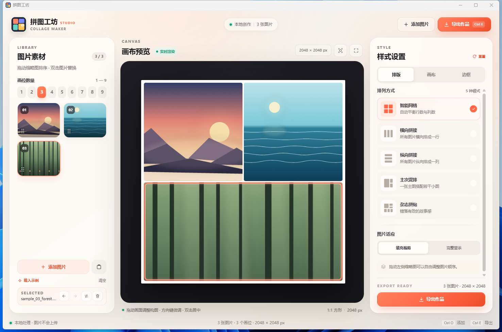

# 拼图工坊 / PinTu Collage

Windows 桌面图片拼贴工具：把 1–9 张图片拼成一张作品。使用 **Tauri 2 + Rust + WebView2 + Canvas** 构建，图片只在本机处理。

A local-first Windows collage maker built with **Tauri 2, Rust, WebView2 and Canvas**. Import 1–9 images, arrange them, and export a finished collage without uploading anything.



## 下载 / Download

- **Windows x64 免安装版**：见 [Releases](../../releases/latest)
- 需要 WebView2 Runtime（Windows 11 自带，Windows 10 通常已随 Edge 安装）

## 功能 / Features

- 1–9 个画位，拖入图片自动设置画位数
- 拖拽缩略图排序、双击替换、移除、清空
- 画布内拖动调整构图，方向键微调，双击居中
- 5 种排版：智能网格、横向、纵向、主次混排、杂志拼贴
- 11 种画布比例：1:1、4:3、3:4、5:4、4:5、3:2、2:3、16:9、9:16、2:1、1:2
- 输出长边 1080 / 1440 / 2048 / 2560 / 3840 px
- 边框开关、粗细、间距、圆角、背景颜色
- 填充裁剪 / 完整显示
- 导出 PNG / JPG / WebP；PNG 无损
- 导出使用渐进式高质量缩放 + 轻量反锐化
- 导出路径输入框，默认程序目录 `Exports`，可改到其他目录
- 导出完成后自动打开目录
- 画布比例、输出尺寸、导出路径、边框等设置自动保存，下次启动复用
- 主界面普通权限运行，资源管理器拖放可用；受保护目录导出时按需请求一次 UAC

## 构建 / Build

要求：

- Windows 10/11 x64
- Rust stable（MSVC toolchain）
- Visual Studio 2022/2026，安装「使用 C++ 的桌面开发」工作负载
- WebView2 Runtime

在仓库根目录运行：

```powershell
powershell -ExecutionPolicy Bypass -File .\build_windows.ps1
```

产物：

```text
dist\拼图工坊.exe
```

也可以直接运行：

```powershell
cargo build --release --manifest-path .\src-tauri\Cargo.toml
```

Tauri 会把 `frontend/` 嵌入 exe，运行时不需要额外携带前端目录。

## 目录 / Layout

```text
frontend/                 静态 HTML/CSS/Canvas 前端
  index.html
  styles.css
  js/app.js               界面、拖放、导出流程
  js/engine.js            排版与比例计算
  js/render.js            Canvas 渲染、高质量缩放
  js/tauri-bridge.js      Tauri invoke 桥接
  samples/                示例图片
src-tauri/
  src/main.rs             Rust：文件读取、写盘、导出 helper
  tauri.conf.json
  capabilities/default.json
  icons/
build_windows.ps1
```

## 隐私 / Privacy

本程序不会上传图片或使用远程服务。所有图片解码、排版、Canvas 合成和导出都在本机完成。详细说明见 [PRIVACY.md](PRIVACY.md)。

This program does not upload images or contact a remote service. All decoding, layout, compositing and export happen locally. See [PRIVACY.md](PRIVACY.md).

## 代码签名政策 / Code signing policy

**Free code signing provided by [SignPath.io](https://about.signpath.io), certificate by [SignPath Foundation](https://signpath.org).**

- 签名范围：由本仓库 GitHub Actions 从带 tag 的提交构建出的 Windows release 二进制。
- 签名审批：每次 release 的签名请求必须由维护者人工批准。
- 角色：
  - Authors / Committers / Reviewers：仓库维护者（GitHub owner）
  - Approvers：仓库维护者（GitHub owner）
- 所有外部贡献通过 Pull Request 提交，并由维护者审查后合并。
- 详细政策：[CODE_SIGNING_POLICY.md](CODE_SIGNING_POLICY.md)\n- **Application status:** submitted to SignPath Foundation on 2026-11-05; pending review.

## 贡献 / Contributing

- 提交前请先运行构建，确认 `dist\拼图工坊.exe` 可以启动。
- 外部 PR 需要维护者审查。
- 安全问题请不要公开提交 Issue，见 [SECURITY.md](SECURITY.md)。

## 许可证 / License

[MIT](LICENSE)

第三方组件与系统库说明见 [THIRD_PARTY_NOTICES.md](THIRD_PARTY_NOTICES.md)。


